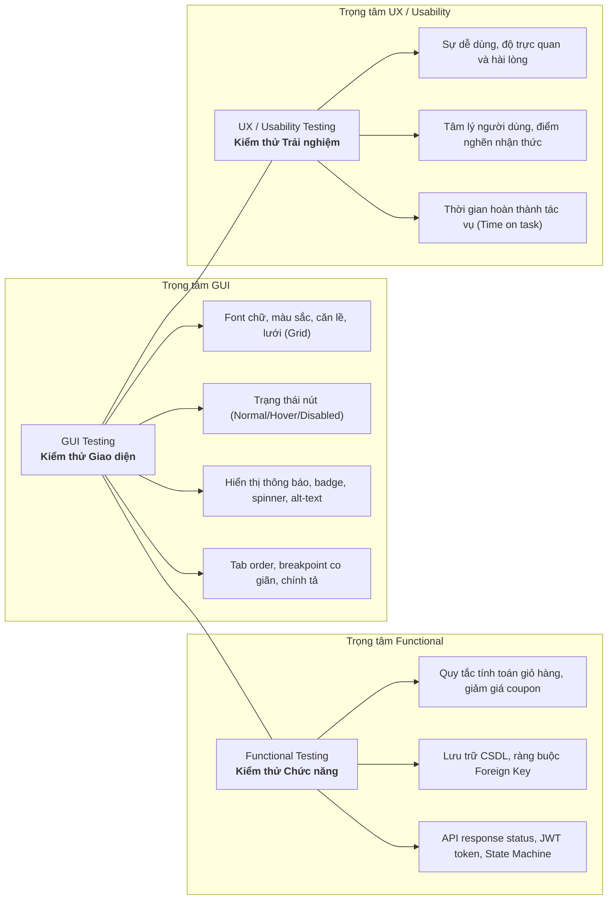
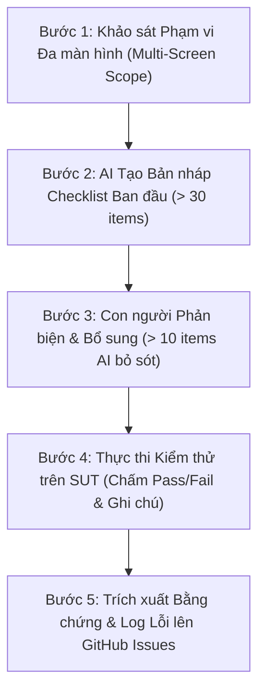

# GUI Testing Skill (GUI Checklist & Defect Logging)

Kỹ năng này hướng dẫn quy trình từng bước áp dụng kỹ thuật **Kiểm thử Giao diện Người dùng (GUI Testing)** để xây dựng bộ **GUI Checklist** hoàn chỉnh (> 40 mục), bao phủ đầy đủ các khía cạnh thị giác, tương tác form, điều hướng, trạng thái và phản hồi theo chuẩn bài giảng môn Kiểm thử Phần mềm (FIT - HCMUS) và tài liệu Seminar Nhóm 05.

---

## 1. Bản chất & Phân định Ranh giới Kiểm thử

Trước khi thực hiện, cần phân biệt rõ ranh giới giữa 3 loại kiểm thử để tránh nhầm lẫn phạm vi:

> **Nguyên tắc cốt lõi**: *"GUI Testing kiểm tra ứng dụng đúng hay sai về mặt thị giác và tương tác giao diện theo thiết kế; Functional Testing kiểm tra dữ liệu và nghiệp vụ bên dưới; Usability Testing kiểm tra ứng dụng dễ hay khó dùng đối với người dùng thực tế."*

---

## 2. Các Nguyên tắc Thiết kế GUI & 4 Nhóm Lỗi Thường gặp

Theo bài giảng Seminar Nhóm 05, một giao diện chuẩn phải tuân thủ 3 nguyên tắc nền tảng:
1. **Consistency (Tính nhất quán)**: Toàn bộ hệ thống phải đồng nhất về bảng màu (palette), phông chữ, khoảng cách đệm (padding/margin), kích cỡ nút bấm và ký hiệu tiền tệ (`₫` vs `VND`) trên mọi màn hình.
2. **Error Prevention (Ngăn ngừa lỗi)**: Thiết kế các chốt chặn ngay trên giao diện để chủ động ngăn chặn lỗi người dùng (ví dụ: giới hạn số ký tự ô nhập, định dạng ngày `MM/YY`, vô hiệu hóa nút submit khi dữ liệu chưa hợp lệ).
3. **System Feedback (Phản hồi hệ thống)**: Mọi thao tác click, rê chuột (hover) hoặc sự kiện bất đồng bộ phải có phản hồi thị giác ngay lập tức trong khoảng **0.1s – 1s** (đổi màu nút, icon xoay loading, toast thông báo).

### 4 Nhóm lỗi GUI trọng yếu:
| Nhóm lỗi | Bản chất | Dấu hiệu nhận biết điển hình trên SUT |
| :--- | :--- | :--- |
| **1. Visual & Layout Bugs** | Lỗi sắp xếp, kích thước, căn lề và hiển thị các thành phần giao diện không khớp lưới thiết kế. | Các nút "Thêm vào giỏ" không thẳng hàng dọc/ngang; thẻ card bị lệch độ cao; vi phạm quy chuẩn 1 thẻ `<h1>` duy nhất trên trang; màu nút hành động bị sai (nút Submit màu đỏ thay vì xanh). |
| **2. State Bugs** | Lỗi trạng thái thành phần giao diện khi tương tác hoặc khi dữ liệu thay đổi. | Click nút "Thêm vào giỏ" không có phản hồi thị giác hoặc phải bấm 2 lần mới nhận; nút không bị disable khi đang loading gây double-submit; trang trống (empty state) thiếu icon minh họa. |
| **3. Responsive Bugs** | Bố cục bị vỡ hoặc che khuất khi thay đổi độ phân giải màn hình / thiết bị. | Menu vỡ trên mobile; text bị tràn hoặc cắt cụt (truncate) vô lý; xuất hiện thanh cuộn ngang ngoài ý muốn (`overflow-x`); form nhập liệu bị bàn phím ảo che mất. |
| **4. Typo & Localization** | Lỗi chính tả, nhãn hiển thị và ngôn ngữ không đồng nhất. | Lẫn lộn tiếng Anh và tiếng Việt ("Sign In" xen kẽ "Đăng nhập", "Thoát" thay vì "Đăng xuất"); tiêu đề trang Login ghi nhầm thành "Đăng Ký"; đơn vị tiền hiển thị lẫn lộn `VND` và `₫`. |

---

## 3. Bốn Khía cạnh Giao diện (Interface Aspects - IA)

Để đảm bảo độ bao phủ toàn diện cho Checklist (> 40 mục), các bài kiểm tra phải được phân bổ đều vào 4 khía cạnh theo chuẩn SUT:

### **IA-01: Tiêu chuẩn Giao diện Chung (General UI Standards)**
- **Nhất quán bảng màu**: Nút tích cực (Submit, Mua hàng) màu xanh dương; nút nguy hiểm/hủy màu đỏ.
- **Đơn vị tiền tệ**: Luôn dùng ký hiệu `₫` với dấu phân cách hàng nghìn (ví dụ: `100.000 ₫`, không dùng `100000 VND`).
- **Thẻ định danh SEO/Cấu trúc**: Mỗi màn hình có đúng **1 thẻ `<h1>` duy nhất** thể hiện mục đích của trang.
- **Căn lề lưới (Alignment)**: Các card sản phẩm, tiêu đề và nút bấm phải thẳng hàng trên cùng trục ngang/dọc.
- **Tính khả truy (Accessibility)**: Độ tương phản màu chữ/nền đạt chuẩn WCAG; có vòng viền focus ring rõ ràng khi nhấn Tab.

### **IA-02: Biểu mẫu & Nhập liệu (Forms & Controls)**
- **Chỉ báo bắt buộc**: Tất cả trường bắt buộc nhập phải có dấu `*` màu đỏ cạnh nhãn.
- **Đúng kiểu input HTML5**: Trường email phải dùng `type="email"`; trường mật khẩu dùng `type="password"` (ẩn ký tự).
- **Vị trí thông báo lỗi**: Thông báo lỗi phải xuất hiện **ngay trên nút submit** hoặc ngay dưới trường nhập lỗi (inline cue), không đặt khuất dưới chân trang.
- **Thứ tự phím Tab (Tab Order)**: Nhấn Tab phải di chuyển focus tuần tự từ trên xuống dưới, từ trái sang phải, không bị nhảy loạn hoặc gán `tabIndex` sai.
- **Step Indicator**: Các quy trình nhiều bước (Quên mật khẩu, Thanh toán) phải có chỉ báo bước rõ ràng ("Bước 1 / 2").

### **IA-03: Điều hướng (Navigation)**
- **Navbar Active State**: Thanh menu điều hướng phải highlight trực quan trang đang được chọn.
- **Badge giỏ hàng**: Icon/Link "Giỏ hàng" phải hiển thị huy hiệu (badge) đếm tổng số lượng món hàng hiện có.
- **Nhãn thoát**: Nút đăng xuất phải mang đúng nhãn "Đăng xuất" (không dùng từ "Thoát").
- **Breadcrumbs**: Các trang con sâu (Chi tiết sản phẩm, Giỏ hàng, Thanh toán) bắt buộc có thanh đường dẫn (Breadcrumbs) với định dạng chuẩn `Trang chủ / Danh mục / Tên sản phẩm`, mục cuối cùng là văn bản tĩnh không click được.

### **IA-04: Phản hồi & Trạng thái (Feedback & State)**
- **Phản hồi tức thì**: Bấm "Thêm vào giỏ hàng" phải hiển thị Toast notification hoặc cập nhật số trên Cart Badge trong vòng 0.5s.
- **Chống thao tác trùng lặp**: Nút bấm phải chuyển sang trạng thái disabled hoặc hiển thị spinner xoay khi đang gửi request.
- **Hộp thoại bảo vệ dữ liệu hủy hoại (Destructive Safeguards)**: Thao tác xóa món hàng khỏi giỏ hoặc xóa người dùng phải bật hộp thoại xác nhận (Confirm Dialog/Modal) trước khi thực hiện.
- **Trạng thái rỗng (Empty State)**: Khi giỏ hàng rỗng hoặc tìm kiếm không ra kết quả, phải hiển thị hình minh họa thân thiện kèm gợi ý hành động ("Tiếp tục mua sắm").
- **Văn bản thay thế ảnh (Image Alt Text)**: Tất cả hình ảnh phải có thuộc tính `alt` mô tả nội dung hình, không để trống `alt=""`.

---

## 4. Công thức Thiết kế Checklist Item Chuẩn mực

Mỗi mục trong GUI Checklist bắt buộc phải tuân theo cấu trúc 3 thành phần định lượng:

$$\mathbf{[Thành\ phần\ thị\ giác]} + \mathbf{[Thao\ tác\ /\ Điều\ kiện]} + \mathbf{[Kết\ quả\ thị\ giác\ mong\ đợi]}$$

**Ví dụ đúng chuẩn:**
> *"Nút [Thêm vào giỏ] tại trang Chi tiết sản phẩm — khi người dùng click lần đầu tiên — phải đổi màu nhẹ, hiển thị badge cập nhật trên thanh Header và xuất hiện Toast thông báo thành công (IA-04)."*

**Ví dụ sai (quá chung chung):**
> *"Kiểm tra nút thêm vào giỏ hàng hoạt động tốt."* $\rightarrow$ Không có tiêu chí đo lường thị giác rõ ràng.

---

## 5. Quy trình 5 Bước Thực thi GUI Testing

### Bước 1: Khảo sát Phạm vi Đa màn hình (Multi-screen Scope)
Không kiểm thử một màn hình đơn lẻ. Hãy chọn luồng người dùng xuyên suốt: **Trang chủ $\rightarrow$ Chi tiết sản phẩm $\rightarrow$ Giỏ hàng $\rightarrow$ Đăng ký / Đăng nhập $\rightarrow$ Quên mật khẩu $\rightarrow$ Thanh toán**.

### Bước 2: AI Tạo Bản nháp Ban đầu
Sử dụng prompt có cấu trúc chặt chẽ, cung cấp SRS và yêu cầu AI sinh các mục kiểm thử theo 4 nhóm IA.

### Bước 3: Con người Phản biện & Bổ sung (Human Review & Refinement)
> [!IMPORTANT]
> **Quy định bắt buộc của HW03**: Sinh viên phải bổ sung thêm các mục mà AI đã bỏ sót và giải thích rõ **tại sao AI bỏ sót** trong báo cáo.
> **Các khía cạnh AI thường bỏ sót:**
> 1. *Accessibility (Hỗ trợ tiếp cận)*: Focus ring khi nhấn Tab, độ tương phản cho người khiếm thị màu.
> 2. *Right-to-Left (RTL) Layout & Responsive Edge Cases*: Vỡ chữ ở màn hình cực nhỏ (< 360px).
> 3. *Logic khiếm khuyết tinh vi đặc thù*: Phải click đúp mới ăn sự kiện, lỗi XSS hiển thị từ khóa tìm kiếm (`dangerouslySetInnerHTML`).
> 4. *Nhất quán nhãn định danh đặc thù theo văn hóa bản địa*: Ký hiệu `₫` sau số tiền so với chữ `VND`.

### Bước 4: Thực thi Kiểm thử trên SUT
1. Mở hệ thống SUT thực tế trên trình duyệt.
2. Kiểm tra từng tiêu chí:
   - Nếu đạt $\rightarrow$ Đánh dấu **Pass**.
   - Nếu vi phạm $\rightarrow$ Đánh dấu **Fail**, ghi rõ lý do thực tế vào cột **Notes / Evidence** và chụp ảnh màn hình lưu vào `docs/screenshots/`.

### Bước 5: Log Lỗi lên GitHub Issues & Báo cáo
Đối với mỗi mục Fail, tạo một Issue trên GitHub theo cấu trúc chuẩn: Tiêu đề rõ ràng, gán nhãn `bug`, các bước tái hiện, kết quả thực tế, kết quả mong đợi và đính kèm ảnh chụp bằng chứng.

---

## 6. Mẫu Bảng GUI Checklist Chuẩn

| # | Khía cạnh (Category) | Thành phần (Checkpoint) | Tiêu chí kiểm chứng (Verification Criteria) | Pass | Fail | Ghi chú & Bằng chứng (Notes / Evidence) |
| :-: | :--- | :--- | :--- | :-: | :-: | :--- |
| 1 | IA-01 (General UI) | Cấu trúc tiêu đề trang Home | Trang Home chỉ có duy nhất 1 thẻ `<h1>` mô tả trang; không có thẻ `<h1>` phụ ở chân trang. | | | |
| 2 | IA-01 (General UI) | Ký hiệu đơn vị tiền tệ | Mọi giá tiền trên sản phẩm đều hiển thị ký hiệu `₫` có phân cách hàng nghìn (ví dụ: `150.000 ₫`), không dùng `VND`. | | | |
| 3 | IA-02 (Forms) | Thuộc tính input mật khẩu | Trường mật khẩu ở form Đăng nhập phải có `type="password"`, che giấu ký tự khi nhập liệu. | | | |
| 4 | IA-02 (Forms) | Vị trí thông báo lỗi | Khi đăng nhập thất bại, thông báo lỗi màu đỏ phải hiển thị phía trên nút submit "Đăng nhập". | | | |
| 5 | IA-03 (Navigation) | Badge số lượng giỏ hàng | Khi giỏ hàng có sản phẩm, icon giỏ hàng trên thanh Header phải hiển thị badge tròn đếm đúng tổng số lượng món. | | | |
| 6 | IA-04 (Feedback/State)| Độ nhạy nút Thêm giỏ hàng | Bấm nút "Thêm vào giỏ hàng" tại Product Detail nhận phản hồi ngay ở lần click đầu tiên, không bắt bấm 2 lần. | | | |
| 7 | IA-04 (Feedback/State)| Dialog xác nhận xóa | Khi bấm nút "Xóa" sản phẩm trong giỏ hàng, hệ thống phải bật dialog hỏi xác nhận trước khi xóa thực tế. | | | |

