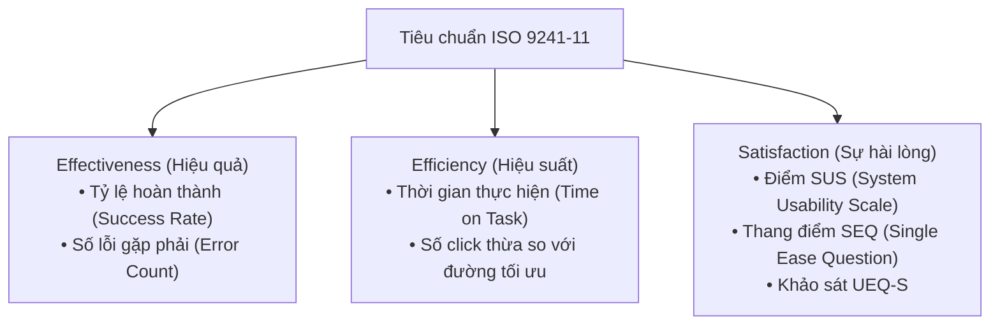
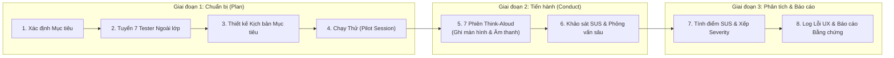

# Usability Testing Skill (Usability Evaluation & SUS/UEQ-S)

Kỹ năng này cung cấp quy trình chuẩn hóa từng bước để lập kế hoạch, điều phối và phân tích **Đánh giá Khả năng Sử dụng (Usability Testing)** cho sản phẩm phần mềm, áp dụng phương pháp quan sát người dùng thực tế nói to suy nghĩ (**Think-Aloud**) kết hợp các thang đo chuẩn quốc tế (**SUS / UEQ-S / SEQ**) và 10 nguyên tắc Heuristic của Jakob Nielsen.

---

## 1. Bản chất & Tiêu chuẩn Quốc tế ISO 9241-11

Usability Testing trả lời câu hỏi cốt lõi: *"Sản phẩm có trực quan, thân thiện và hoạt động hiệu quả đối với người dùng thực tế hay không?"*

Theo chuẩn quốc tế **ISO 9241-11**, khả năng sử dụng được đo lường qua 3 trụ cột:
1. **Tính Hiệu quả (Effectiveness)**: Người dùng có hoàn thành được mục tiêu của nhiệm vụ một cách chính xác và trọn vẹn không? (Đo bằng *Task Success Rate*).
2. **Tính Hiệu suất (Efficiency)**: Người dùng tiêu tốn bao nhiêu thời gian, công sức và số bước thao tác để đạt được mục tiêu? (Đo bằng *Time on Task*, *Error Rate*, số click thừa).
3. **Sự Hài lòng (Satisfaction)**: Cảm giác chủ quan, mức độ thoải mái và sự tin tưởng của người dùng đối với phần mềm? (Đo bằng thang đo *SUS*, *UEQ-S*, *SEQ*).

---

## 2. Quy trình 8 Bước Thực thi Usability Testing Chuẩn mực

Quy trình được chia thành 3 giai đoạn chính theo bài giảng môn học:

---

### GIAI ĐOẠN 1: LẬP KẾ HOẠCH & CHUẨN BỊ (PLAN & PREPARE)

#### Bước 1: Xác định Mục tiêu Đánh giá
Xác định rõ ràng giả thuyết hoặc điểm nghi ngờ trong giao diện người dùng (ví dụ: *Người dùng có gặp khó khăn khi tìm và áp dụng mã giảm giá tại bước thanh toán không? Tỷ lệ vấp lỗi khi nhập thông tin hồ sơ là bao nhiêu?*).

#### Bước 2: Thiết kế Kịch bản Mục tiêu (Goal-Oriented Task Scenario)
> [!IMPORTANT]
> **Nguyên tắc vàng**: Cho người dùng **MỤC TIÊU CẦN ĐẠT ĐƯỢC**, tuyệt đối **KHÔNG CẦM TAY CHỈ VIỆC** từng bước click chuột.
> - **Kịch bản đúng (Goal-oriented)**: *"Bạn đang cần mua một chiếc áo ấm với ngân sách dưới 500.000 ₫. Hãy tìm sản phẩm ưng ý, thêm vào giỏ hàng và hoàn tất đặt hàng có sử dụng một mã giảm giá phù hợp."*
> - **Kịch bản sai (Step-by-step)**: *"Bấm vào ô tìm kiếm, gõ chữ Áo, click sản phẩm số 1, bấm nút Thêm giỏ, bấm giỏ hàng, nhập SAVE10 rồi bấm Đặt hàng."* $\rightarrow$ Kịch bản này làm mất đi tính chân thực của kiểm thử khả năng sử dụng.

#### Bước 3: Chuẩn bị Công cụ Đo lường (Instruments)
1. **SEQ (Single Ease Question)**: Hỏi ngay sau khi kết thúc tác vụ: *"Nhìn chung, bạn thấy nhiệm vụ vừa rồi dễ hay khó?"* (Thang điểm 1 - Rất khó đến 7 - Rất dễ).
2. **SUS (System Usability Scale)**: Bảng câu hỏi chuẩn 10 mục thực hiện ngay khi kết thúc buổi test (chi tiết tại mục 3).
3. **Bộ câu hỏi phỏng vấn đào sâu (Probe Questions)**: Tối thiểu bao phủ 4 khía cạnh:
   - *Clarity (Độ rõ ràng)*: Thành phần nào trên màn hình khiến bạn bối rối hoặc khó hiểu nhất?
   - *Error Recovery (Khả năng khắc phục lỗi)*: Khi gặp sự cố hoặc thông báo lỗi, bạn có hiểu nguyên nhân và biết cách tự sửa không?
   - *Speed & Efficiency (Tốc độ)*: Quá trình thao tác có bước nào làm bạn cảm thấy rườm rà, tốn thời gian vô ích?
   - *Trust & Confidence (Độ tin cậy)*: Bạn có cảm thấy yên tâm và tin tưởng khi nhập thông tin cá nhân và thanh toán trên trang web này không?

#### Bước 4: Tuyển chọn Người tham gia & Chạy Thử (Pilot Session)
- **Số lượng**: Tuyển đúng **7 người tham gia thực tế**.
- **Điều kiện ràng buộc (Anti-Cheat)**: Người tham gia phải là **người ngoài lớp học môn Kiểm thử**. Ưu tiên người dùng phổ thông (Non-IT) để có góc nhìn tự nhiên nhất. Thu thập thông tin định danh xác thực: Họ tên, nghề nghiệp, số điện thoại / Zalo (che 4 số giữa, ví dụ: `0901***456`).
- **Phiên Pilot (Chạy thử 1 người)**: Bắt buộc tiến hành thử nghiệm trước với 1 người để phát hiện kịch bản diễn đạt khó hiểu, môi trường mạng chập chờn hoặc thời gian bị kéo dài, từ đó hoàn thiện kịch bản trước khi test chính thức 7 người.

---

### GIAI ĐOẠN 2: ĐIỀU PHỐI PHIÊN KIỂM THỬ (CONDUCT SESSIONS)

1. **Thiết lập tâm lý (Set the stage)**: Nhấn mạnh với người tham gia: *"Chúng tôi đang kiểm tra sự thân thiện của ứng dụng, hoàn toàn KHÔNG kiểm tra năng lực của bạn. Bất kỳ khó khăn nào bạn gặp phải đều là khuyết điểm của phần mềm."*
2. **Kỹ thuật Nói to Suy nghĩ (Think-Aloud Protocol)**: Hướng dẫn người dùng liên tục nói ra những gì họ đang nhìn thấy, suy nghĩ, dự đoán và cảm nhận trong suốt quá trình thao tác.
3. **Quan sát Trung lập (Neutral Observation)**: Người điều phối giữ thái độ trung lập tuyệt đối, **không gợi ý, không giải thích giao diện và không chỉ dẫn cách làm**. Chỉ can thiệp khi người dùng hoàn toàn bế tắc (stuck) sau hơn 2 phút và đánh dấu nhiệm vụ đó là thất bại (Failed).
4. **Ghi chép có Cấu trúc (Structured Observation Log)**: Ghi lại mốc thời gian (timestamp), các điểm nghẽn (friction points), sự ngập ngừng (hesitations), số lần click nhầm, và những câu nói phàn nàn của người dùng. Ghi hình màn hình và âm thanh (khi có sự đồng ý).

---

### GIAI ĐOẠN 3: PHÂN TÍCH, XẾP HẠNG & BÁO CÁO (ANALYSE & REPORT)

#### 1. Tính toán Điểm Thang đo SUS (System Usability Scale)
Bảng câu hỏi gồm 10 mục đan xen tích cực (lẻ) và tiêu cực (chẵn), chấm điểm từ 1 (Hoàn toàn không đồng ý) đến 5 (Hoàn toàn đồng ý):
- Với các câu lẻ $(1, 3, 5, 7, 9)$: $Score_i = \text{Điểm trả lời} - 1$
- Với các câu chẵn $(2, 4, 6, 8, 10)$: $Score_i = 5 - \text{Điểm trả lời}$
- **Điểm SUS Tổng**:
  $$\text{SUS Score} = \left(\sum_{i=1}^{10} Score_i\right) \times 2.5 \quad (0 \le \text{SUS} \le 100)$$

**Thang đối chiếu chuẩn mực SUS:**
| Điểm SUS | Đánh giá Khả năng Sử dụng |
| :---: | :--- |
| **> 80.3** | **Xuất sắc (Grade A)**: Sản phẩm rất dễ dùng và làm hài lòng người dùng. |
| **68.0 – 80.3** | **Tốt / Trên trung bình (Grade B/C)**: Mức chấp nhận được trong ngành công nghiệp. |
| **51.0 – 67.9** | **Dưới trung bình (Grade D)**: Giao diện gây khó khăn, cần cải tiến nhiều. |
| **< 51.0** | **Kém / Nghiêm trọng (Grade F)**: Sản phẩm gặp vấn đề nghiêm trọng, người dùng dễ bỏ dở. |

#### 2. Phân loại Mức độ Nghiêm trọng của Vấn đề (Severity Ranking)
Tổng hợp toàn bộ khó khăn của 7 người dùng và xếp theo 4 mức độ:
- **Blocker (Chặn đứng)**: Khiến người dùng hoàn toàn không thể hoàn thành nhiệm vụ (ví dụ: nút thanh toán bị ẩn, click không ăn, lỗi 500).
- **Major (Nghiêm trọng)**: Gây ra sự ức chế lớn, tốn nhiều thời gian vòng vo hoặc suýt dẫn đến thất bại (ví dụ: thông báo lỗi sai lệch, mã coupon thỏa mãn điều kiện nhưng bị từ chối vô lý).
- **Minor (Nhẹ)**: Gây bối rối thoáng qua nhưng người dùng vẫn tự khắc phục được (ví dụ: nhãn nút chưa tự nhiên, font chữ hơi nhỏ, vị trí link khó thấy).
- **Cosmetic / Suggestion (Góp ý thẩm mỹ)**: Góp ý về màu sắc, bố cục hoặc tính năng bổ trợ mong muốn.

#### 3. Báo cáo Khiếm khuyết UX lên GitHub Issues
Mỗi vấn đề Usability nghiêm trọng được tạo thành Issue trên GitHub kèm theo video/ảnh chụp màn hình minh chứng khoảnh khắc người dùng gặp trở ngại.

---

## 3. Mười Nguyên tắc Heuristic của Jakob Nielsen (Công cụ Phân tích Insight)

Khi tổng hợp các phát hiện Usability, ánh xạ vấn đề vào 10 nguyên tắc Heuristic kinh điển:
1. **Visibility of system status**: Luôn hiển thị trạng thái hệ thống rõ ràng (loading spinner, tiến trình).
2. **Match between system and real world**: Sử dụng ngôn ngữ đời thường, biểu tượng quen thuộc (giỏ hàng, địa chỉ giao hàng).
3. **User control and freedom**: Có nút Hoàn tác (Undo), Quay lại, Hủy thao tác, xác nhận trước khi xóa.
4. **Consistency and standards**: Đồng nhất nút bấm, phông chữ, quy chuẩn thanh toán phổ biến.
5. **Error prevention**: Thiết kế ngăn chặn lỗi trước khi nó xảy ra (ràng buộc số điện thoại, gợi ý mật khẩu).
6. **Recognition rather than recall**: Gợi ý trực quan để người dùng nhận ra thay vì phải nhớ lại thông tin cũ.
7. **Flexibility and efficiency of use**: Hỗ trợ phím tắt, thao tác nhanh cho người dùng thành thạo.
8. **Aesthetic and minimalist design**: Bố cục tinh gọn, không nhồi nhét thông tin dư thừa.
9. **Help users recognize, diagnose, and recover from errors**: Báo lỗi bằng ngôn ngữ dễ hiểu, chỉ rõ cách khắc phục.
10. **Help and documentation**: Có tài liệu hỗ trợ, hướng dẫn sử dụng và mục giải đáp thắc mắc (FAQ).

---

## 4. Nguyên tắc Hợp tác với AI trong Usability Testing

- **AI hỗ trợ (AI Assists)**: Tạo kịch bản task scenario giả định, sinh dữ liệu người dùng mẫu, phân tích bản ghi chép phỏng vấn để rút ra từ khóa cảm xúc, tổng hợp công thức tính điểm SUS.
- **Con người quyết định (Human Validates)**: Toàn bộ quá trình tuyển người thật, quan sát trực tiếp cử chỉ ánh mắt, lắng nghe giọng nói bộc lộ sự ức chế và xác nhận lỗi thực tế đều phải do con người thực hiện 100%. Tuyệt đối không dùng AI để ngụy tạo kết quả người dùng.

