# BÁO CÁO LỖI GIAO DIỆN & ĐA TRÌNH DUYỆT (BUG REPORT) — PHÂN HỆ M2

- **Môn học:** Kiểm thử Phần mềm (FIT - HCMUS) — Bài tập lớn HW03
- **Thành viên thực hiện (M2):** Lê Trung Thành Đạt — MSSV: `23120228` (`23120228@student.hcmus.edu.vn`)
- **Hệ thống kiểm thử (SUT):** EShop Web (`http://localhost:5173`, Backend API `http://localhost:3000`)
- **Trang GitHub Issues:** [https://github.com/otis275275/testing-hw03/issues](https://github.com/otis275275/testing-hw03/issues)
- **Tổng số lỗi ghi nhận:** **23 lỗi** (**22 lỗi GUI** từ Task 1 đã log đầy đủ lên GitHub Issues `#1`–`#22` + **1 lỗi Cross-Browser** từ Task 3 trên Mozilla Firefox tại `CHK-23`).

---

## 1. Bằng chứng Trang GitHub Issues (Task 1 — 22 Open Issues)

Toàn bộ 22 khiếm khuyết phát hiện từ 49 mục GUI Checklist (`CHK-01` $\rightarrow$ `CHK-49`) đã được tạo thành Issue độc lập kèm nhãn phân loại (`bug`, `gui-testing`, `IA-01..04`, `M2`) và ảnh chụp màn hình đính kèm trên từng Issue:

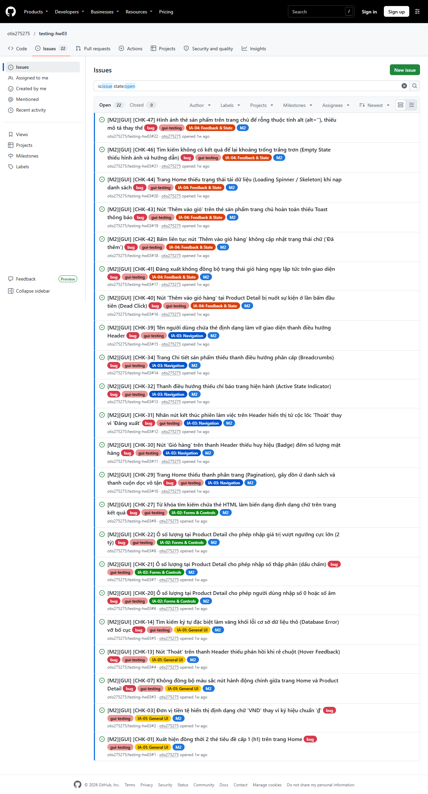

*Hình 1: Toàn bộ 22 Issues đang mở trên trang GitHub Issues (`otis275275/testing-hw03`).*

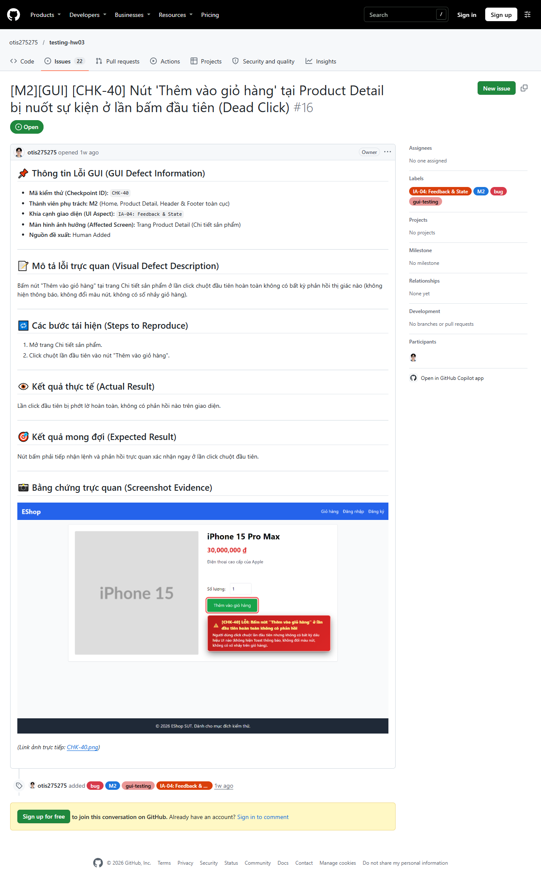

*Hình 2: Minh họa chi tiết Issue `#16` (`CHK-40` — Dead Click nút "Thêm vào giỏ hàng") có đầy đủ bước tái hiện và ảnh chụp đính kèm.*

---

## 2. Bảng Tổng hợp Danh mục Lỗi (22 GitHub Issues + 1 Lỗi Cross-Browser)

| Mã lỗi | GitHub Issue | Mã Checkpoint | Khía cạnh | Màn hình | Mức độ | Tóm tắt lỗi |
| :---: | :---: | :---: | :---: | :--- | :---: | :--- |
| `BUG-01` | [#1](https://github.com/otis275275/testing-hw03/issues/1) | `CHK-01` | IA-01 | Home | Minor | Xuất hiện đồng thời 2 thẻ `<h1>` trên trang Home |
| `BUG-02` | [#2](https://github.com/otis275275/testing-hw03/issues/2) | `CHK-03` | IA-01 | Home | Minor | Đơn vị tiền tệ hiển thị `VND` thay vì ký hiệu chuẩn `₫` |
| `BUG-03` | [#3](https://github.com/otis275275/testing-hw03/issues/3) | `CHK-07` | IA-01 | Home / Detail | Minor | Không đồng bộ màu nút "Thêm vào giỏ" (xanh dương vs xanh lá) |
| `BUG-04` | [#4](https://github.com/otis275275/testing-hw03/issues/4) | `CHK-13` | IA-01 | Header | Minor | Nút "Thoát" trên Header thiếu phản hồi Hover |
| `BUG-05` | [#5](https://github.com/otis275275/testing-hw03/issues/5) | `CHK-14` | IA-01 | Home (Search) | **Major** | Tìm ký tự `'` làm văng lỗi thô `Database Error SQLITE_ERROR` vỡ bố cục |
| `BUG-06` | [#6](https://github.com/otis275275/testing-hw03/issues/6) | `CHK-20` | IA-02 | Product Detail | **Major** | Ô số lượng cho phép nhập số `0` hoặc số âm (ví dụ `-5`) |
| `BUG-07` | [#7](https://github.com/otis275275/testing-hw03/issues/7) | `CHK-21` | IA-02 | Product Detail | **Major** | Ô số lượng cho phép nhập số thập phân (`0.5`), nuốt lệnh không báo lỗi |
| `BUG-08` | [#8](https://github.com/otis275275/testing-hw03/issues/8) | `CHK-22` | IA-02 | Product Detail | **Major** | Ô số lượng cho phép nhập giá trị cực lớn (`2000000000`) không cảnh báo |
| `BUG-09` | [#9](https://github.com/otis275275/testing-hw03/issues/9) | `CHK-27` | IA-02 | Home (Search) | **Critical** | Từ khóa tìm kiếm chứa HTML (`<b>`) bị render trực tiếp trên DOM (XSS) |
| `BUG-10` | [#10](https://github.com/otis275275/testing-hw03/issues/10) | `CHK-29` | IA-03 | Home | Minor | Trang Home thiếu phân trang (Pagination), dồn ứ cuộn dọc khi nhiều SP |
| `BUG-11` | [#11](https://github.com/otis275275/testing-hw03/issues/11) | `CHK-30` | IA-03 | Header | **Major** | Nút "Giỏ hàng" trên Header thiếu badge đếm số lượng mặt hàng |
| `BUG-12` | [#12](https://github.com/otis275275/testing-hw03/issues/12) | `CHK-31` | IA-03 | Header | Minor | Nhãn nút đăng xuất hiển thị `"Thoát"` thay vì `"Đăng xuất"` |
| `BUG-13` | [#13](https://github.com/otis275275/testing-hw03/issues/13) | `CHK-32` | IA-03 | Header | Minor | Thanh điều hướng không highlight trang hiện tại (Active State) |
| `BUG-14` | [#14](https://github.com/otis275275/testing-hw03/issues/14) | `CHK-34` | IA-03 | Product Detail | Minor | Thiếu thanh điều hướng phân cấp (Breadcrumbs) |
| `BUG-15` | [#15](https://github.com/otis275275/testing-hw03/issues/15) | `CHK-39` | IA-03 | Header | **Critical** | Tên người dùng chứa HTML bị render trực tiếp trên Header (XSS) |
| `BUG-16` | [#16](https://github.com/otis275275/testing-hw03/issues/16) | `CHK-40` | IA-04 | Product Detail | **Critical** | Nút "Thêm vào giỏ hàng" bị Dead Click ở lần bấm đầu tiên |
| `BUG-17` | [#17](https://github.com/otis275275/testing-hw03/issues/17) | `CHK-41` | IA-04 | Header / Cart | **Major** | Đăng xuất không đồng bộ làm sạch giỏ hàng ngay trên giao diện |
| `BUG-18` | [#18](https://github.com/otis275275/testing-hw03/issues/18) | `CHK-42` | IA-04 | Product Detail | **Major** | Click liên tục nút "Thêm vào giỏ hàng" không phản hồi ổn định |
| `BUG-19` | [#19](https://github.com/otis275275/testing-hw03/issues/19) | `CHK-43` | IA-04 | Home | **Major** | Bấm "Thêm vào giỏ" tại thẻ sản phẩm Home thiếu Toast/hiệu ứng xác nhận |
| `BUG-20` | [#20](https://github.com/otis275275/testing-hw03/issues/20) | `CHK-44` | IA-04 | Home | Minor | Trang Home thiếu Loading Spinner / Skeleton khi chờ API |
| `BUG-21` | [#21](https://github.com/otis275275/testing-hw03/issues/21) | `CHK-46` | IA-04 | Home (Search) | **Major** | Tìm kiếm không có kết quả để vùng danh sách trắng trơn (thiếu Empty State) |
| `BUG-22` | [#22](https://github.com/otis275275/testing-hw03/issues/22) | `CHK-47` | IA-04 | Home | Minor | Ảnh thẻ sản phẩm trên trang chủ để rỗng thuộc tính `alt=""` |
| `BUG-23` | *(Task 3)* | `CHK-23` | IA-02 | Product Detail | **Major** | **Cross-Browser (Firefox):** Cho phép gõ và hiển thị chữ `"abc"` trong ô số lượng |

---

## 3. Chi tiết Các Lỗi Kèm Ảnh Chụp Bằng Chứng

### BUG-01 (`CHK-01`) — Xuất hiện đồng thời 2 thẻ `<h1>` trên trang Home
- **GitHub Issue:** [#1](https://github.com/otis275275/testing-hw03/issues/1) | **Khía cạnh:** IA-01 | **Mức độ:** Minor
- **Tái hiện:** Mở `http://localhost:5173/`, kiểm tra phân cấp tiêu đề trên trang chủ.
- **Thực tế / Mong đợi:** Xuất hiện 2 tiêu đề cấp 1 (`"Danh sách sản phẩm"` ở đầu trang và `"Hiển thị X sản phẩm"` ở cuối trang); theo FR-05/FR-21 mỗi trang chỉ được có 1 thẻ `<h1>`.

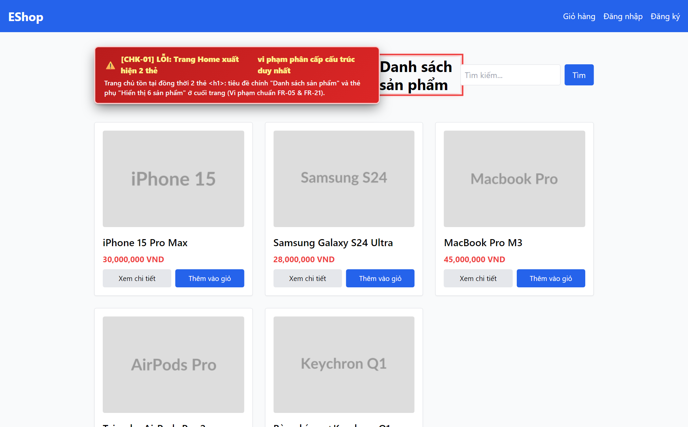

---

### BUG-02 (`CHK-03`) — Đơn vị tiền tệ hiển thị `'VND'` thay vì `'₫'`
- **GitHub Issue:** [#2](https://github.com/otis275275/testing-hw03/issues/2) | **Khía cạnh:** IA-01 | **Mức độ:** Minor
- **Tái hiện:** Mở trang chủ `http://localhost:5173/` và quan sát giá trên các thẻ sản phẩm.
- **Thực tế / Mong đợi:** Hiển thị dạng `30,000,000 VND`, thiếu đồng bộ với trang Chi tiết sản phẩm (`30,000,000 ₫`) và quy chuẩn FR-05/FR-21.

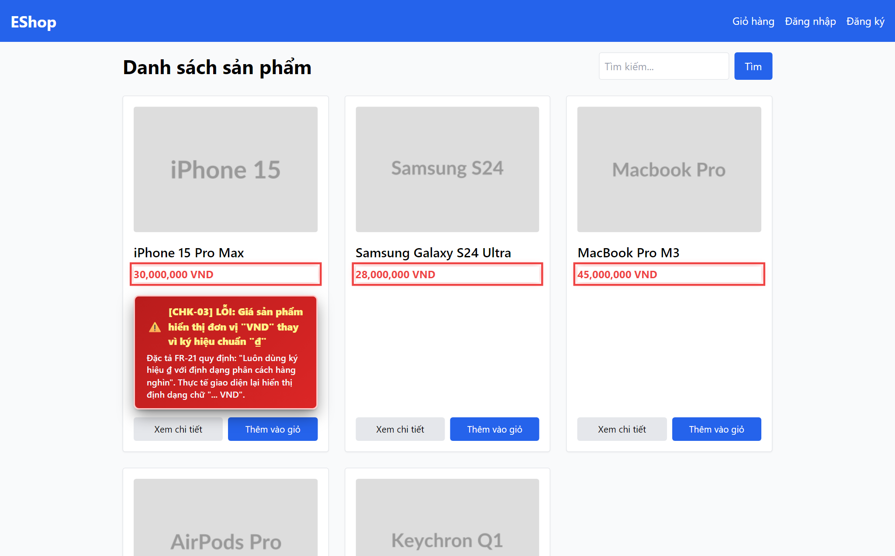

---

### BUG-03 (`CHK-07`) — Không đồng bộ màu sắc nút hành động chính
- **GitHub Issue:** [#3](https://github.com/otis275275/testing-hw03/issues/3) | **Khía cạnh:** IA-01 | **Mức độ:** Minor
- **Tái hiện:** So sánh màu nút "Thêm vào giỏ" trên trang Home và nút "Thêm vào giỏ hàng" tại `/product/:id`.
- **Thực tế / Mong đợi:** Trang Home dùng màu xanh dương (`bg-blue-600`), trang Detail lại dùng màu xanh lá (`bg-green-600`), trái quy chuẩn màu xanh dương cho hành động chính (FR-21).

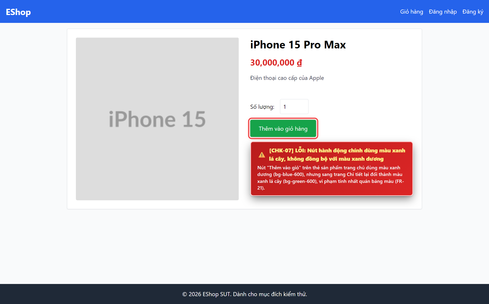

---

### BUG-04 (`CHK-13`) — Nút 'Thoát' trên Header thiếu phản hồi Hover
- **GitHub Issue:** [#4](https://github.com/otis275275/testing-hw03/issues/4) | **Khía cạnh:** IA-01 | **Mức độ:** Minor
- **Tái hiện:** Đăng nhập tài khoản, di chuột lên nút `Thoát` ở góc phải Header.
- **Thực tế / Mong đợi:** Màu nền giữ nguyên (`rgb(239, 68, 68)`), không có hiệu ứng hover chuyển sắc độ như các nút khác.

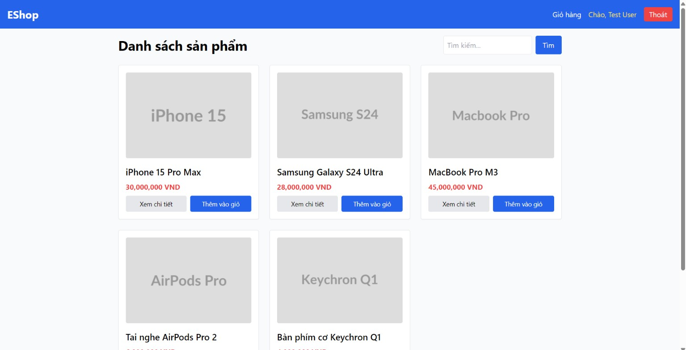

---

### BUG-05 (`CHK-14`) — Tìm kiếm ký tự `'` văng khối lỗi Database Error thô
- **GitHub Issue:** [#5](https://github.com/otis275275/testing-hw03/issues/5) | **Khía cạnh:** IA-01 | **Mức độ:** Major
- **Tái hiện:** Nhập dấu nháy đơn `'` vào ô tìm kiếm trang Home và bấm `Tìm`.
- **Thực tế / Mong đợi:** Hiển thị khối đỏ in nguyên văn `Database Error - SQLITE_ERROR: unrecognized token...`; hệ thống cần parameterized query và thông báo lỗi thân thiện.

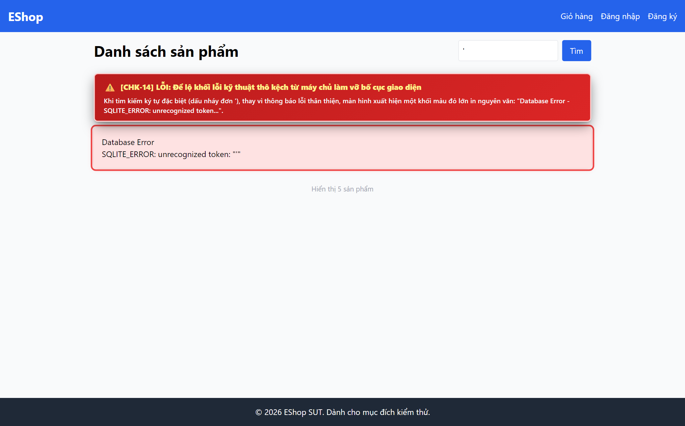

---

### BUG-06 (`CHK-20`) — Ô số lượng cho phép nhập số `0` hoặc số âm
- **GitHub Issue:** [#6](https://github.com/otis275275/testing-hw03/issues/6) | **Khía cạnh:** IA-02 | **Mức độ:** Major
- **Tái hiện:** Mở trang Product Detail (`/product/1`), gõ `-5` hoặc `0` vào ô `Số lượng:`.
- **Thực tế / Mong đợi:** Ô nhập liệu chấp nhận số âm mà không chặn hoặc báo lỗi; cần ràng buộc `min="1"` theo FR-06.

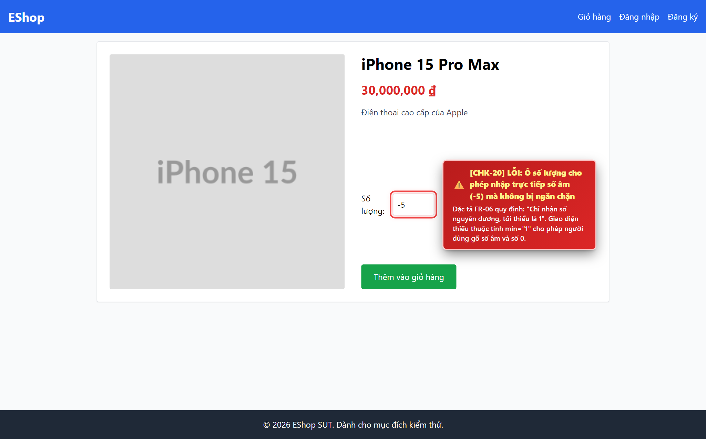

---

### BUG-07 (`CHK-21`) — Ô số lượng cho phép nhập số thập phân (`0.5`)
- **GitHub Issue:** [#7](https://github.com/otis275275/testing-hw03/issues/7) | **Khía cạnh:** IA-02 | **Mức độ:** Major
- **Tái hiện:** Tại Product Detail, nhập `0.5` vào ô số lượng và bấm `Thêm vào giỏ hàng`.
- **Thực tế / Mong đợi:** Ô nhập chấp nhận `0.5` rồi chuyển thành `0` khi thêm vào giỏ (hoặc nuốt thao tác không cảnh báo); phải chặn dấu thập phân và chỉ nhận số nguyên dương.

---

### BUG-08 (`CHK-22`) — Ô số lượng chấp nhận giá trị vượt ngưỡng cực lớn (`2000000000`)
- **GitHub Issue:** [#8](https://github.com/otis275275/testing-hw03/issues/8) | **Khía cạnh:** IA-02 | **Mức độ:** Major
- **Tái hiện:** Tại Product Detail, nhập `2000000000` vào ô số lượng.
- **Thực tế / Mong đợi:** Không có giới hạn `max` hợp lý hay cảnh báo giới hạn đặt hàng.

---

### BUG-09 (`CHK-27`) — Từ khóa tìm kiếm chứa thẻ HTML bị render trực tiếp (XSS)
- **GitHub Issue:** [#9](https://github.com/otis275275/testing-hw03/issues/9) | **Khía cạnh:** IA-02 | **Mức độ:** Critical
- **Tái hiện:** Tìm kiếm từ khóa `<b>test</b>` hoặc `<h1>test</h1>` trên trang Home.
- **Thực tế / Mong đợi:** Văn bản kết quả bị định dạng HTML thật thay vì escape dạng chuỗi thuần an toàn (FR-05, SEC-04).

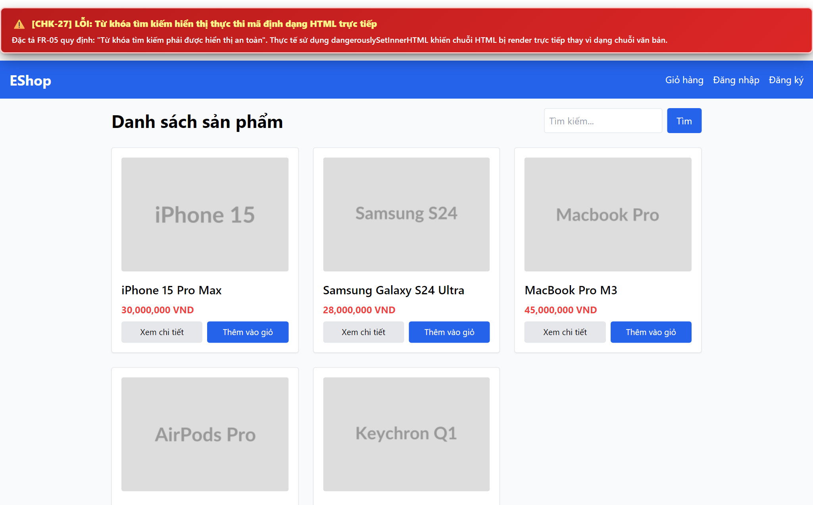

---

### BUG-10 (`CHK-29`) — Trang Home thiếu phân trang (Pagination)
- **GitHub Issue:** [#10](https://github.com/otis275275/testing-hw03/issues/10) | **Khía cạnh:** IA-03 | **Mức độ:** Minor
- **Tái hiện:** Khi danh sách sản phẩm nhiều, quan sát đáy trang Home.
- **Thực tế / Mong đợi:** Toàn bộ sản phẩm đổ dồn vào một trang dài vô tận, thiếu thanh phân trang hoặc nút "Xem thêm".

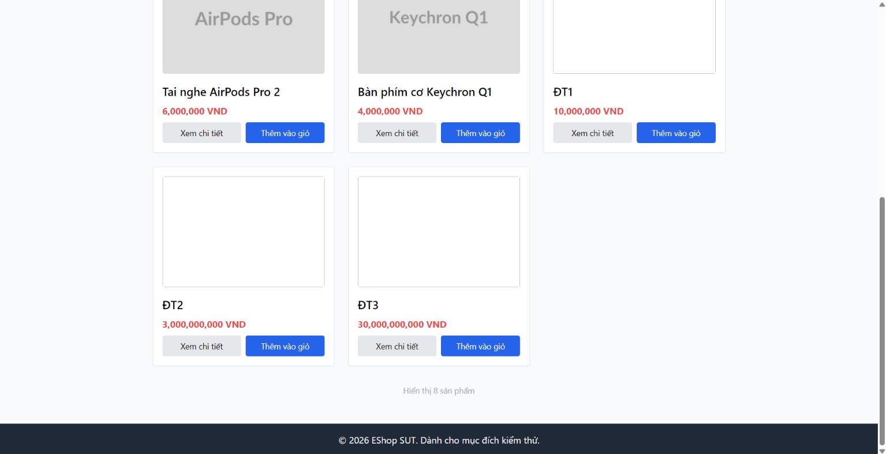

---

### BUG-11 (`CHK-30`) — Nút 'Giỏ hàng' trên Header thiếu huy hiệu đếm số lượng (Badge)
- **GitHub Issue:** [#11](https://github.com/otis275275/testing-hw03/issues/11) | **Khía cạnh:** IA-03 | **Mức độ:** Major
- **Tái hiện:** Thêm sản phẩm vào giỏ hàng rồi quan sát liên kết `Giỏ hàng` trên thanh Header.
- **Thực tế / Mong đợi:** Chỉ có chữ `Giỏ hàng` trơn, không có badge hiển thị số lượng món đang có (FR-23).

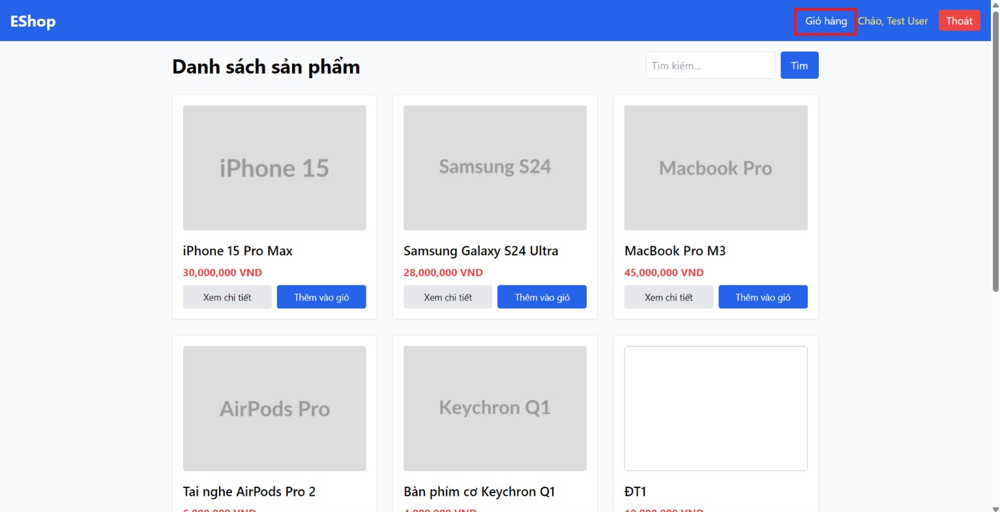

---

### BUG-12 (`CHK-31`) — Nhãn nút đăng xuất hiển thị `'Thoát'` thay vì `'Đăng xuất'`
- **GitHub Issue:** [#12](https://github.com/otis275275/testing-hw03/issues/12) | **Khía cạnh:** IA-03 | **Mức độ:** Minor
- **Tái hiện:** Đăng nhập thành công và quan sát nút bên cạnh lời chào trên Header.
- **Thực tế / Mong đợi:** Hiển thị chữ `"Thoát"` thay vì nhãn chuẩn `"Đăng xuất"` theo FR-23.

---

### BUG-13 (`CHK-32`) — Thanh điều hướng thiếu chỉ báo trang hiện hành (Active State)
- **GitHub Issue:** [#13](https://github.com/otis275275/testing-hw03/issues/13) | **Khía cạnh:** IA-03 | **Mức độ:** Minor
- **Tái hiện:** Chuyển qua lại giữa Trang chủ, Giỏ hàng, Đăng nhập và quan sát thanh Header.
- **Thực tế / Mong đợi:** Không có mục nào được highlight (gạch chân/đổi màu) để báo cho người dùng biết đang ở trang nào (FR-23).

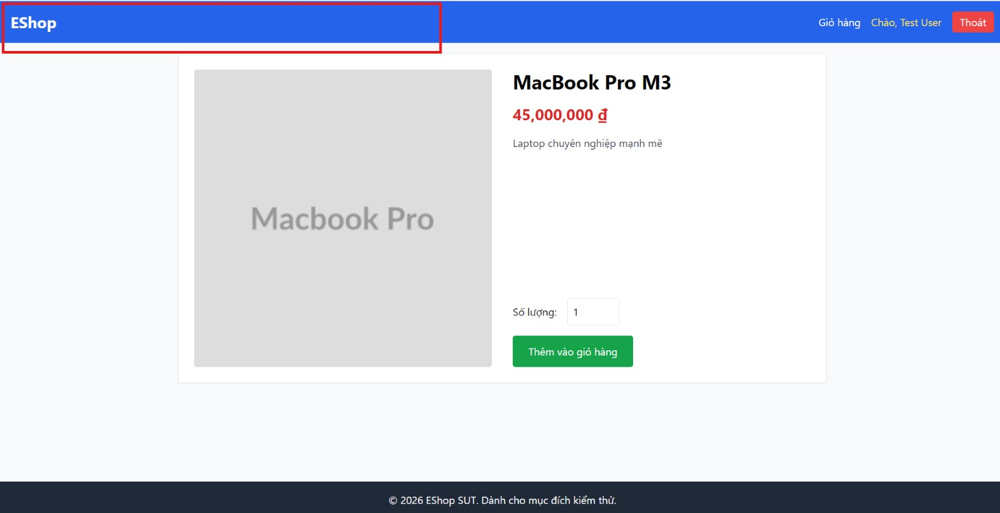

---

### BUG-14 (`CHK-34`) — Trang Chi tiết sản phẩm thiếu Breadcrumbs
- **GitHub Issue:** [#14](https://github.com/otis275275/testing-hw03/issues/14) | **Khía cạnh:** IA-03 | **Mức độ:** Minor
- **Tái hiện:** Bấm `Xem chi tiết` để mở `/product/:id`.
- **Thực tế / Mong đợi:** Không có thanh đường dẫn `Trang chủ / Tên sản phẩm` theo FR-23.

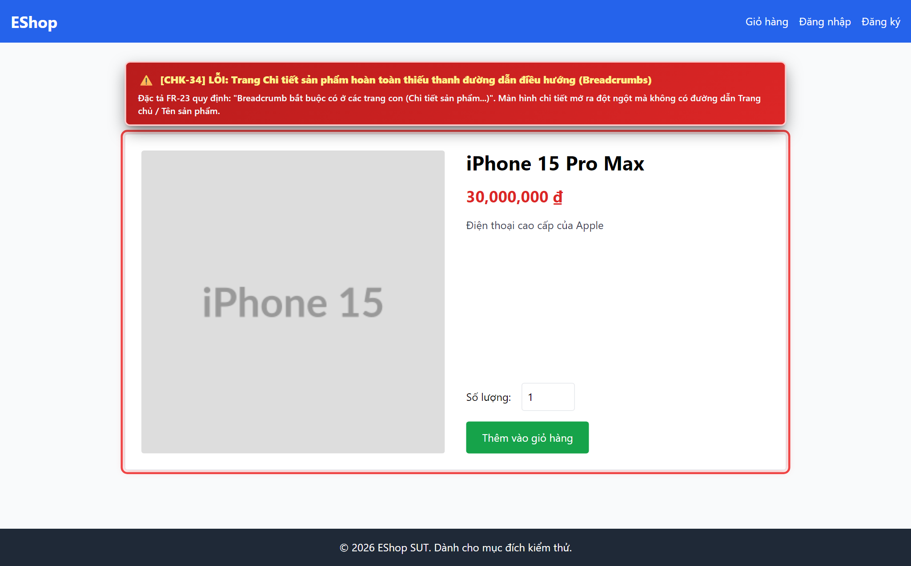

---

### BUG-15 (`CHK-39`) — Tên người dùng chứa thẻ HTML bị render trên Header (XSS)
- **GitHub Issue:** [#15](https://github.com/otis275275/testing-hw03/issues/15) | **Khía cạnh:** IA-03 | **Mức độ:** Critical
- **Tái hiện:** Đăng ký/cập nhật tên tài khoản chứa thẻ HTML (VD: `<b>User</b>`) và đăng nhập.
- **Thực tế / Mong đợi:** Lời chào trên Header render trực tiếp thẻ HTML thay vì hiển thị text an toàn (SEC-04).

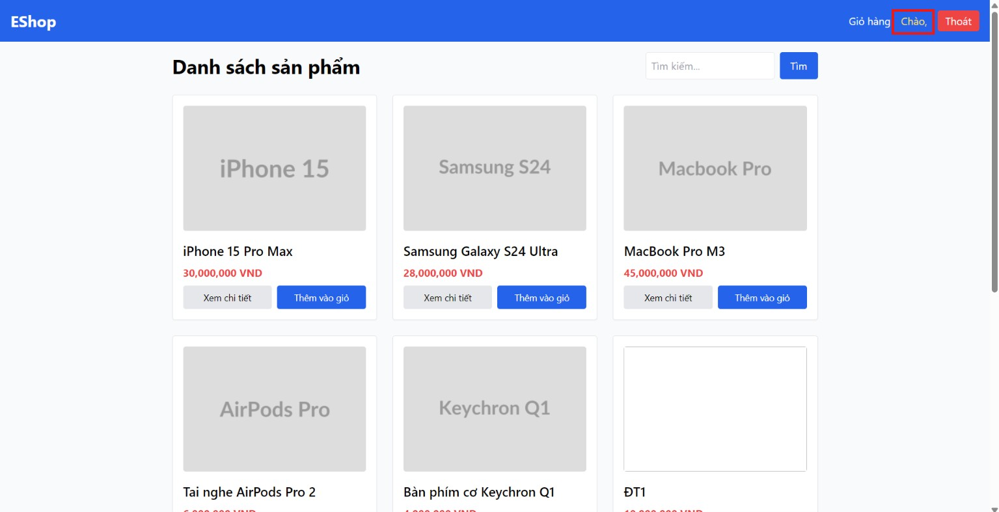

---

### BUG-16 (`CHK-40`) — Nút 'Thêm vào giỏ hàng' tại Product Detail bị Dead Click ở lần bấm đầu
- **GitHub Issue:** [#16](https://github.com/otis275275/testing-hw03/issues/16) | **Khía cạnh:** IA-04 | **Mức độ:** Critical
- **Tái hiện:** Mở Product Detail, bấm nút `Thêm vào giỏ hàng` 1 lần.
- **Thực tế / Mong đợi:** Lần click đầu tiên bị nuốt hoàn toàn (không đổi chữ nút, không thêm sản phẩm vào giỏ); chỉ từ lần click thứ hai trở đi mới thực hiện.

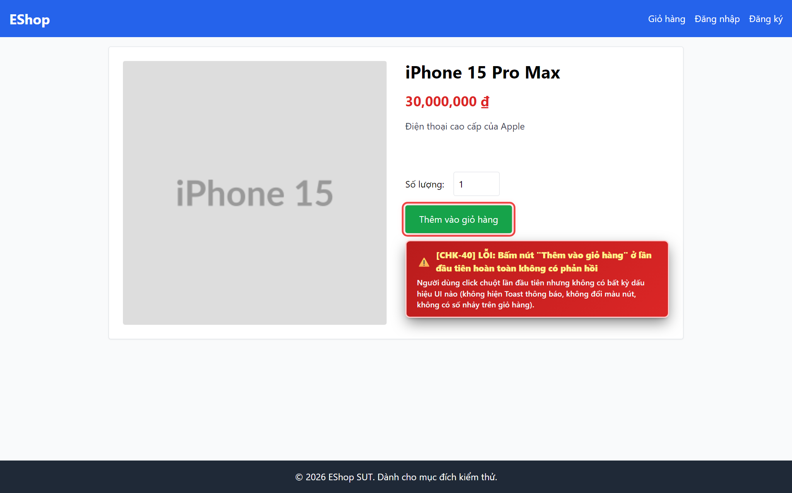

---

### BUG-17 (`CHK-41`) — Đăng xuất không làm mới trạng thái giỏ hàng ngay lập tức
- **GitHub Issue:** [#17](https://github.com/otis275275/testing-hw03/issues/17) | **Khía cạnh:** IA-04 | **Mức độ:** Major
- **Tái hiện:** Thêm sản phẩm vào giỏ khi đang đăng nhập $\rightarrow$ bấm `Thoát` $\rightarrow$ bấm vào `Giỏ hàng` mà không F5.
- **Thực tế / Mong đợi:** Dữ liệu giỏ hàng cũ vẫn còn hiển thị trên UI; phải nhấn F5 mới biến mất.

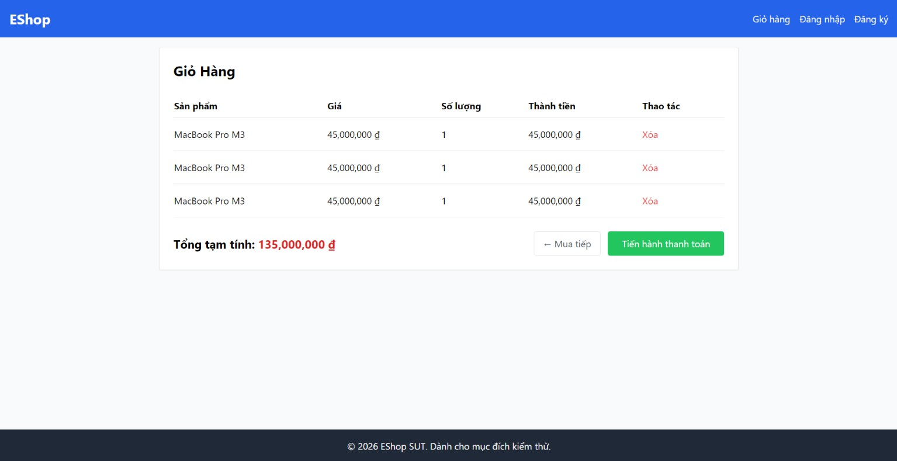

---

### BUG-18 (`CHK-42`) — Click liên tục nút 'Thêm vào giỏ hàng' không phản hồi ổn định
- **GitHub Issue:** [#18](https://github.com/otis275275/testing-hw03/issues/18) | **Khía cạnh:** IA-04 | **Mức độ:** Major
- **Tái hiện:** Click liên tiếp 3 lần vào nút `Thêm vào giỏ hàng` tại Product Detail.
- **Thực tế / Mong đợi:** Lần 1 và lần 3 bị nuốt lệnh, chỉ lần 2 mới đổi sang `"Đã thêm"`, gây sai lệch số lượng trong giỏ và thiếu Toast thông báo ổn định.

---

### BUG-19 (`CHK-43`) — Bấm 'Thêm vào giỏ' tại Home thiếu phản hồi trực quan
- **GitHub Issue:** [#19](https://github.com/otis275275/testing-hw03/issues/19) | **Khía cạnh:** IA-04 | **Mức độ:** Major
- **Tái hiện:** Bấm nút `Thêm vào giỏ` ngay trên thẻ sản phẩm ở trang chủ.
- **Thực tế / Mong đợi:** Không có Toast thông báo, không đổi nhãn nút, không có badge cập nhật (FR-24).

---

### BUG-20 (`CHK-44`) — Trang Home thiếu Loading Spinner / Skeleton khi tải API
- **GitHub Issue:** [#20](https://github.com/otis275275/testing-hw03/issues/20) | **Khía cạnh:** IA-04 | **Mức độ:** Minor
- **Tái hiện:** Giả lập mạng chậm (Slow 3G) và mở trang chủ.
- **Thực tế / Mong đợi:** Khoảng trống trắng trước khi API `/api/products` trả về không có biểu tượng loading hay skeleton (FR-05).

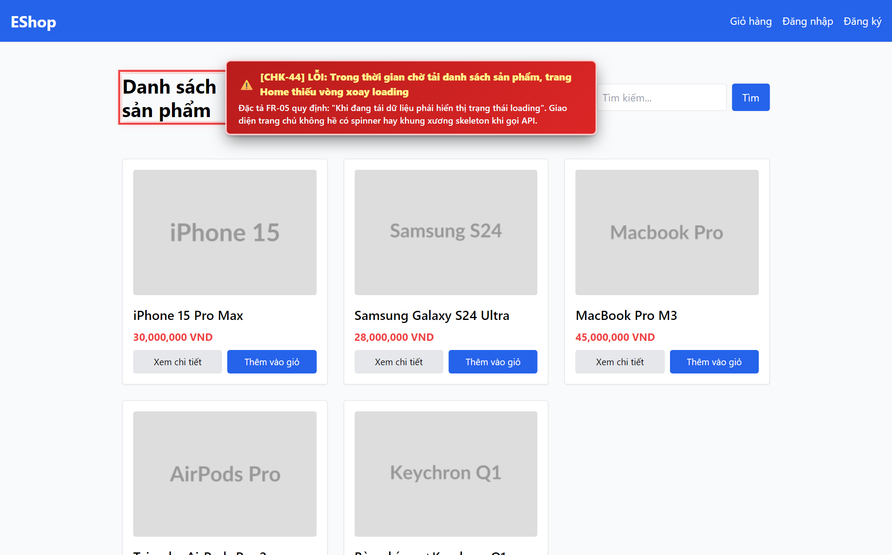

---

### BUG-21 (`CHK-46`) — Tìm kiếm không có kết quả thiếu Empty State hướng dẫn
- **GitHub Issue:** [#21](https://github.com/otis275275/testing-hw03/issues/21) | **Khía cạnh:** IA-04 | **Mức độ:** Major
- **Tái hiện:** Nhập từ khóa không tồn tại (VD: `"Sony"` hoặc `"khongtontai"`) và bấm `Tìm`.
- **Thực tế / Mong đợi:** Vùng danh sách trắng trơn, không có hình minh họa hay câu thông báo `"Không tìm thấy sản phẩm"` (FR-05, FR-24).

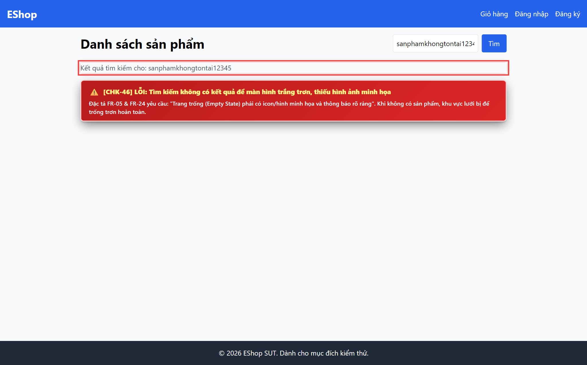

---

### BUG-22 (`CHK-47`) — Ảnh thẻ sản phẩm trên trang chủ để rỗng `alt=""`
- **GitHub Issue:** [#22](https://github.com/otis275275/testing-hw03/issues/22) | **Khía cạnh:** IA-04 | **Mức độ:** Minor
- **Tái hiện:** Kiểm tra thuộc tính `alt` của ảnh sản phẩm trên trang Home (hoặc khi ảnh lỗi URL).
- **Thực tế / Mong đợi:** Toàn bộ ảnh sản phẩm có `alt=""` thay vì mô tả tên sản phẩm (FR-05, FR-24).

---

### BUG-23 (`CHK-23` — Phát hiện ở Task 3) — Mozilla Firefox cho phép nhập chữ cái `'abc'` vào ô Số lượng
- **Nguồn phát hiện:** Task 3 Cross-Browser Testing (`Chrome` & `Safari/WebKit` PASS, `Mozilla Firefox` **FAIL**) | **Khía cạnh:** IA-02 | **Mức độ:** Major
- **Tái hiện:** Mở Product Detail (`/product/1`) trên **Mozilla Firefox**, xóa trắng ô `Số lượng:` và gõ `"abc"`.
- **Thực tế:** Firefox cho phép hiển thị chữ `"abc"` bên trong ô `<input type="number">` và đặt `validity.badInput = true` (do ứng dụng chỉ dựa vào hành vi mặc định của trình duyệt mà không lọc ký tự bằng JS handler).
- **Mong đợi:** Chặn hoàn toàn ký tự không phải chữ số trên mọi trình duyệt (Chrome, Firefox, Safari).

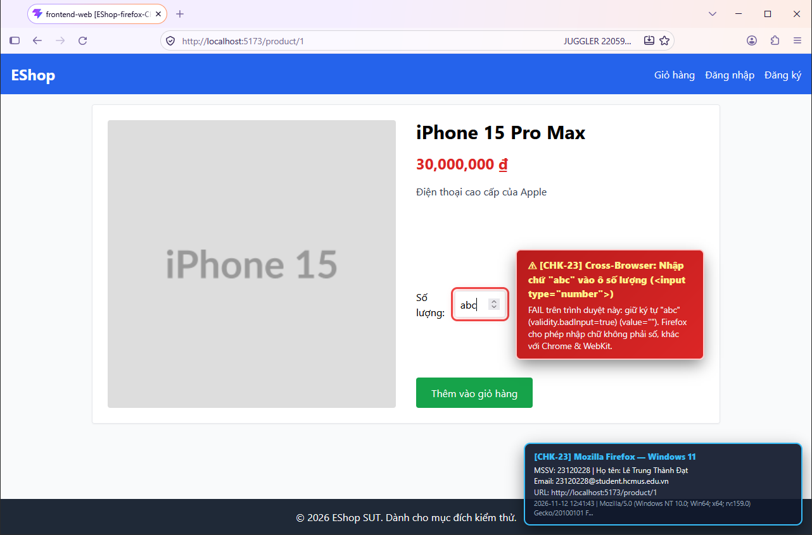

