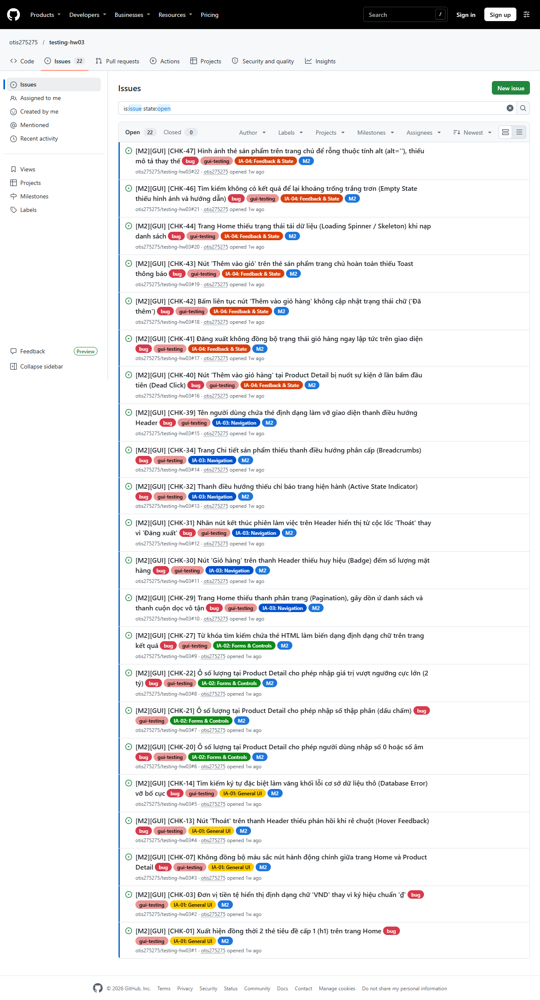
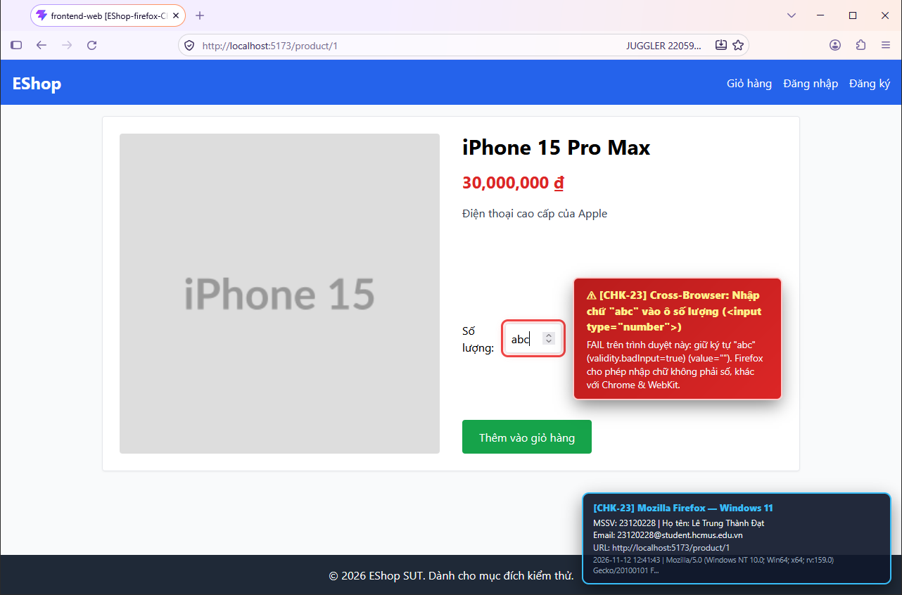

# BÁO CÁO CHÍNH BÀI TẬP LỚN HW03 — GUI & USABILITY TESTING

- **Môn học:** Kiểm thử Phần mềm (FIT - HCMUS) — Bài tập lớn **HW03**
- **Sinh viên thực hiện:** **Lê Trung Thành Đạt** — MSSV: `23120228` (`23120228@student.hcmus.edu.vn`)
- **Phân công trong nhóm:** Thành viên **M2** *(chống trùng lặp theo §5 đề bài)*
- **Hệ thống cần kiểm thử (SUT):** **EShop** (`http://localhost:5173`, Backend API `http://localhost:3000`)
- **Repository GitHub & Issues:** [https://github.com/otis275275/testing-hw03](https://github.com/otis275275/testing-hw03) · [GitHub Issues (#1–#22)](https://github.com/otis275275/testing-hw03/issues)

---

## 1. Phạm vi Phân công & Chống trùng lặp (§5 Scope Selection)

Để bảo đảm không trùng lặp màn hình chính hay luồng nghiệp vụ với các thành viên khác trong nhóm, thành viên **M2** phụ trách độc lập các phạm vi sau:

| Hạng mục | Phạm vi thực hiện của M2 | Ranh giới loại trừ |
| :--- | :--- | :--- |
| **Task 1 — GUI Checklist** | **Trang Home** *(Danh sách sản phẩm + Thanh tìm kiếm)*, **Trang Product Detail**, **Header & Footer toàn cục** *(Web)* | Không kiểm tra màn hình Giỏ hàng (`/cart`), Checkout, Auth hay Web Admin. |
| **Task 2 — Usability Evaluation (Flow F2)** | **Tìm sản phẩm theo nhu cầu $\rightarrow$ Xem chi tiết $\rightarrow$ Chọn số lượng & Thêm vào giỏ $\rightarrow$ Vào `/cart` xác minh sản phẩm đã vào giỏ $\rightarrow$ Quay về Home** *(FR-05 / FR-06)* | Phiên dừng ngay sau khi xác nhận hàng đã nằm trong giỏ; không chỉnh sửa giỏ, không dùng coupon, không checkout. |
| **Task 3 — Cross-Browser** | Toàn bộ **49 mục GUI Checklist** của M2 trên 3 engine trình duyệt: **Chrome**, **Firefox**, **Safari/WebKit** | — |
| **Task 4 — Agent Skills** | 2 bộ Skill chuẩn hóa: `gui-testing` & `usability-testing` (kèm `references/`, `resources/`, `examples/`) | — |

---

## 2. Task 1 — Thiết kế, Phản biện & Thực thi GUI Checklist (> 40 mục)

### 2.1. Quy trình Phối hợp AI – Con người
1. **AI-Generated Draft (40 mục — 81.6%):** AI sinh bộ checklist ban đầu dựa trên đặc tả SRS (`FR-05`, `FR-06`, `FR-21`–`FR-24`) và 4 khía cạnh giao diện `IA-01` $\rightarrow$ `IA-04`.
2. **Human Critical Review & Addition (9 mục — 18.4%):** Con người rà soát phản biện bản nháp, phát hiện các điểm mù của AI và bổ sung thêm 9 mục thực chiến (`CHK-13`, `CHK-14`, `CHK-21`, `CHK-22`, `CHK-27`, `CHK-29`, `CHK-39`, `CHK-40`, `CHK-41`), nâng tổng số lên **49 mục kiểm tra**.

| Khía cạnh giao diện | Tổng mục | AI-Generated | Human Added | PASS | FAIL | Tỷ lệ PASS |
| :--- | :---: | :---: | :---: | :---: | :---: | :---: |
| **IA-01: General UI Standards** | 14 | 12 | 2 | 9 | 5 | 64.3% |
| **IA-02: Forms & Controls** | 13 | 10 | 3 | 9 | 4 | 69.2% |
| **IA-03: Navigation** | 12 | 10 | 2 | 6 | 6 | 50.0% |
| **IA-04: Feedback & State** | 10 | 8 | 2 | 3 | 7 | 30.0% |
| **TỔNG CỘNG** | **49** | **40 (81.6%)** | **9 (18.4%)** | **27** | **22** | **55.1%** |

### 2.2. Các điểm nổi bật từ Phản biện của Con người (Why AI Missed Them)
- **Độ nhạy tương tác động & logic trạng thái ẩn (`CHK-13`, `CHK-40`, `CHK-41`):** AI chỉ kiểm tra sự tồn tại tĩnh của nút `onClick` hoặc màu nút, bỏ sót lỗi **Dead Click** ở lần bấm đầu tiên nút *"Thêm vào giỏ hàng"* (`clickCount === 0`), thiếu hiệu ứng hover trên nút *"Thoát"*, và trạng thái giỏ hàng không đồng bộ ngay khi đăng xuất.
- **Kiểm thử biên tiêu cực (`CHK-21`, `CHK-22`):** AI chỉ thử số dương hợp lệ (`1`, `2`), bỏ qua giá trị thập phân (`0.5`) và số vượt ngưỡng (`2,000,000,000`).
- **Giao diện an toàn & dữ liệu lớn (`CHK-14`, `CHK-27`, `CHK-29`, `CHK-39`):** AI chỉ test từ khóa bình thường với ít sản phẩm; con người thử ký tự `'`, thẻ HTML `<b>` và danh mục dài mới phát hiện lỗi hiển thị `Database Error SQLITE_ERROR` thô, render HTML trực tiếp trên DOM, và thiếu phân trang.

### 2.3. Tài liệu & Báo cáo lỗi Task 1
- **Checklist Markdown chi tiết (49 mục):** [`testcase/gui_checklist_m2.md`](../testcase/gui_checklist_m2.md)
- **Checklist Excel (`.xlsx` — 3 sheet):** [`testcase/gui_checklist_m2.xlsx`](../testcase/gui_checklist_m2.xlsx)
- **Báo cáo lỗi & GitHub Issues (22 Issues `#1`–`#22`):** [`report/bug_report.md`](./bug_report.md)

---

## 3. Task 2 — Đánh giá Khả năng Sử dụng (Usability Evaluation — Trạng thái Hiện tại)

> [!NOTE]
> Theo yêu cầu đề bài, Task 2 bắt buộc thu thập phản hồi từ **1 người Pilot + 7 người tham gia thật ngoài lớp HW03** (TA sẽ gọi xác minh ngẫu nhiên 2/7 người). Toàn bộ dữ liệu chưa thực thi không được phép bịa đặt hay điền mẫu giả.

### 3.1. Giai đoạn 1 — Kế hoạch & Công cụ Đo lường (Đã hoàn thành)
Tài liệu chi tiết tại [`report/task2_phase1_plan_and_instruments.md`](./task2_phase1_plan_and_instruments.md), gồm:
- **5 mục tiêu đánh giá:** Findability & Search Clarity, Comprehension & Error Prevention, System Status Visibility, Navigation Bottlenecks, và Confidence/Speed/Trust.
- **Kịch bản mục tiêu (Goal-Oriented Scenario):** Yêu cầu người dùng tự kiểm tra độ tin cậy cửa hàng, tìm mua **2 chiếc tai nghe chống ồn** ngân sách $\le 6.000.000$ ₫/chiếc (kích hoạt tìm kiếm `"Sony"` rỗng $\rightarrow$ `"tai nghe"` $\rightarrow$ `Tai nghe AirPods Pro 2`), thêm vào giỏ và kiểm tra trong `/cart`.
- **Bộ công cụ chuẩn:** Lời dẫn *Set the Stage + Think-Aloud*, quy tắc quan sát trung lập (chỉ gợi ý tối thiểu sau 2 phút kẹt), **SEQ (1–7)**, bảng **SUS 10 câu** tiếng Việt chuẩn hóa, **5 câu phỏng vấn mở** (Clarity, Error Recovery, Speed, Trust, Session-specific), biểu mẫu **Observation Log Sheet**, và biểu mẫu web hỗ trợ điều phối tại [`scripts/task2_usability_form.html`](../scripts/task2_usability_form.html).

### 3.2. Giai đoạn 2 — Thu thập Dữ liệu Thực tế (`2 / 7` phiên hoàn chỉnh)
Biên bản ghi nhận tại [`report/task2_phase2_session_logs.md`](./task2_phase2_session_logs.md):
- **Đã hoàn thành `P1`:** **Hà Anh Tuấn** (Sinh viên IT năm 4 — VGU, SĐT `093****045`, ngoài lớp HW03) — [Video P1](https://youtu.be/hSGZJhJrAhA) + [`candidate 1 transcript`](./%5BVietnamese%20%28auto-generated%29%5D%20Software%20Testing%20homework%203%20-%20candidate%201%20%5BDownSub.com%5D.txt) | **Kết quả:** Thành công hoàn toàn | **SEQ:** `6/7` | **SUS:** `82.5/100` *(Grade A — có ghi chú kiểm tra Q6, Q9)*.
- **Đã hoàn thành `P2`:** **Trần Kim Ngân** (Sinh viên IT năm 4 — HCMUS, SĐT `098****128`, chờ xác nhận ngoài lớp HW03) — [Video P2](https://youtu.be/1EfXQpylgmQ) | **Kết quả:** Thành công hoàn toàn *(có nhắc bước từ ĐPV)* | **SEQ:** `6/7` | **SUS:** `92.5/100` *(Grade A — chủ động trừ 1 điểm ở Q5 vì thiếu thông báo)*.
- **Đã ghi nhận định danh `P3`:** **Đinh Ngọc Khánh** (Sinh viên IT — HCMUT, ngoài lớp HW03; chưa thực hiện phỏng vấn). **Pilot** và **`P4`–`P7`** chưa thu thập do giới hạn thời gian.

### 3.3. Giai đoạn 3 — Phân tích & Tổng hợp Kết quả trên Mẫu Thực tế (`n = 2`)
Báo cáo chi tiết tại [`report/task2_phase3_analysis_and_report.md`](./task2_phase3_analysis_and_report.md):
- **Chỉ số định lượng (`P1`, `P2`):** Tỷ lệ hoàn thành Flow F2 đạt **`100%` (`2/2`)**, điểm **SEQ trung bình = `6.0 / 7`**, điểm **SUS trung bình = `87.5 / 100`** (`82.5` và `92.5` — Grade A). Điểm SUS cao một phần do cả 2 ứng viên đều là sinh viên IT năm 4 có khả năng tự suy luận giao diện.
- **Điểm nghẽn UX nổi bật (Systemic Design Issues):**
  1. **`UX-01` (Major — `2/2` người gặp):** Thiếu hoàn toàn Toast xác nhận & Badge đếm số lượng trên Header sau khi bấm *"Thêm vào giỏ hàng"* (`P1` phải vào `/cart` tự kiểm chứng; `P2` trừ điểm ở SUS Q5 vì *"không thấy nó thông báo nhỉ"*), ánh xạ trực tiếp tới GitHub Issues [`#11`](https://github.com/otis275275/testing-hw03/issues/11), [`#16`](https://github.com/otis275275/testing-hw03/issues/16), [`#18`](https://github.com/otis275275/testing-hw03/issues/18), [`#19`](https://github.com/otis275275/testing-hw03/issues/19).
  2. **`UX-02` (Minor $\rightarrow$ Major — `2/2` người gặp):** Đứt gãy dẫn hướng bước tiếp theo sau khi xem chi tiết/thêm giỏ (thiếu Breadcrumbs, Active State và CTA chuyển nhanh sang `/cart` — Issues [`#13`](https://github.com/otis275275/testing-hw03/issues/13), [`#14`](https://github.com/otis275275/testing-hw03/issues/14)).
  3. **`UX-03` (Cosmetic/Scope — `1/2` người nêu):** Dữ liệu demo chỉ có 5 sản phẩm nên giảm ý nghĩa tìm kiếm (`P1` chấm SUS Q1 = `3/5`; liên quan phân trang Issue [`#10`](https://github.com/otis275275/testing-hw03/issues/10)).

---

## 4. Task 3 — Kiểm thử Đa trình duyệt (Cross-Browser Testing)

Toàn bộ 49 mục kiểm tra của M2 được thực thi tự động trên trình duyệt thực thông qua [`scripts/capture_task3_cross_browser.js`](../scripts/capture_task3_cross_browser.js) với 3 engine đại diện:

| Nền tảng / Trình duyệt | Engine | Tổng mục | PASS | FAIL | Tỷ lệ PASS | Ghi chú khác biệt |
| :--- | :--- | :---: | :---: | :---: | :---: | :--- |
| **Google Chrome (Windows 11)** | Blink / Chromium | 49 | 27 | 22 | 55.1% | 22 lỗi GUI chung |
| **Mozilla Firefox (Windows 11)** | Gecko (`rv:159.0`) | 49 | 26 | 23 | 53.1% | **+1 lỗi riêng `CHK-23`** |
| **Safari / WebKit Engine** | Apple WebKit (`605.1.15`) | 49 | 27 | 22 | 55.1% | Đồng nhất với Chrome |

### Phát hiện khác biệt Cross-Browser (`CHK-23`)
- Trên **Chrome** và **Safari/WebKit**, ô `<input type="number">` ở trang Product Detail tự chặn khi gõ chữ `"abc"` (`value=""`, `validity.badInput=false`).
- Trên **Mozilla Firefox**, trình duyệt cho phép gõ và **hiển thị trực tiếp chuỗi `"abc"`** bên trong ô số lượng kèm `validity.badInput=true`, do SUT không viết handler lọc ký tự phía JavaScript.
- Toàn bộ 69 ảnh chụp bằng chứng (23 ảnh/trình duyệt) đều hiển thị overlay định danh `MSSV: 23120228`, họ tên `Lê Trung Thành Đạt`, email `23120228@student.hcmus.edu.vn`, URL và timestamp. Chi tiết xem tại [`report/task3_cross_browser.md`](./task3_cross_browser.md).

---

## 5. Task 4 — Agent Skills & Tự động hóa

Hai Agent Skills đã được đóng gói đầy đủ tại [`skills/`](../skills/) (đồng bộ với [`.agents/skills/`](../.agents/skills/)):
1. **`gui-testing`** ([`skills/gui-testing/SKILL.md`](../skills/gui-testing/SKILL.md)): Chuẩn hóa công thức viết checklist, phân biệt GUI vs Functional vs Usability, 4 khía cạnh IA-01..IA-04 và quy trình phản biện lỗi AI bỏ sót.
2. **`usability-testing`** ([`skills/usability-testing/SKILL.md`](../skills/usability-testing/SKILL.md)): Chuẩn hóa ISO 9241-11, quy trình 8 bước, kịch bản Goal-Oriented, Think-Aloud, công thức SUS/UEQ-S và ánh xạ 10 Heuristic của Jakob Nielsen.

- **Video Demo YouTube (sử dụng Agent Skills):** [https://youtu.be/MBv7Ssz-0uY](https://youtu.be/MBv7Ssz-0uY)

---

## 6. Danh mục Phụ lục Liên quan
- Báo cáo lỗi chi tiết & GitHub Issues: [`report/bug_report.md`](./bug_report.md)
- Báo cáo Cross-Browser chi tiết: [`report/task3_cross_browser.md`](./task3_cross_browser.md)
- Nhận xét phản biện AI (200–300 từ): [`report/AI_critique.md`](./AI_critique.md)
- Nhật ký sử dụng AI đầy đủ: [`AI.log.md`](../AI.log.md)
- Lịch sử Git Commit: [`git_commit_log.txt`](../git_commit_log.txt)

